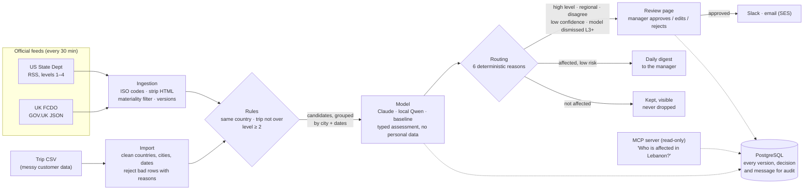

# Travel Risk Agent

Reads official government travel advisories (US State Department, UK FCDO), matches them against
a company's upcoming trips, uses an LLM to judge who is affected and why, drafts the messages,
and lets a travel manager approve them before anything is sent.

**The design choice that matters most:** rules decide who *could* be affected, the model only
judges and explains, and a person approves anything high-risk. The model can escalate a case to
a human but can never make one disappear.

[](https://github.com/martinGele/travel-risk-agent/actions/workflows/ci.yml)
[](https://github.com/martinGele/travel-risk-agent/actions/workflows/eval.yml)

## How it works



## Results

Same 50 labelled scenarios for each model, run end to end (import → rules → model → routing).
Details and every mistake: [`evals/results/`](evals/results/). Method: [`evals/README.md`](evals/README.md).

<!-- RESULTS_TABLE -->

## What's in the box

| Area | Where |
|---|---|
| Feed ingestion, materiality, versioning | `src/travel_risk/ingestion/` |
| Matching and routing rules (the contract) | [`docs/MATCHING_RULES.md`](docs/MATCHING_RULES.md), `matching/rules.py` |
| Severity rubric (shared by prompt, labels, reviewers) | [`docs/SEVERITY_RUBRIC.md`](docs/SEVERITY_RUBRIC.md) |
| Model layer: Claude, Ollama, rules-only baseline | `src/travel_risk/llm/` |
| Assessment pipeline, review, digest | `assess/`, `notify/` |
| REST API (Swagger at `/docs`) and review page (`/ui`) | `api/`, `web/` |
| Read-only MCP server | `mcp_server.py`, [`docs/MCP.md`](docs/MCP.md) |
| Eval set, runner, LLM judge, CI gate | `evals/`, `.github/workflows/eval.yml` |
| AWS deployment (ECS Fargate, RDS, CloudFront, EventBridge) | `infra/`, [`docs/DEPLOY.md`](docs/DEPLOY.md) |
| 3-minute demo script | [`docs/DEMO_SCRIPT.md`](docs/DEMO_SCRIPT.md) |
| Every deviation from the original brief, and why | [`docs/DECISIONS.md`](docs/DECISIONS.md) |

## Run it locally

```bash
docker compose up -d db                      # PostgreSQL 17.11 on port 5433
cp .env.example .env                         # choose a model provider (see below)
uv sync
uv run alembic upgrade head
uv run travel-risk sync                      # real advisories (~30 s the first time)
uv run travel-risk seed-demo                 # demo organisation + messy CSV; prints its API key
uv run uvicorn travel_risk.api.main:app --reload
open http://localhost:8000/ui                # sign in with that key
```

Simulate a crisis without waiting for a real one:

```bash
uv run travel-risk simulate-advisory --source uk_fcdo --country FR --level 4 \
    --text "FCDO advises against all travel to France due to nationwide unrest."
```

**Model provider** (`TRA_MODEL_PROVIDER` in `.env`):

| Value | Model | Needs |
|---|---|---|
| `heuristic` (default) | Rules-only baseline: never dismisses, weak precision | nothing |
| `ollama` | Qwen 2.5 7B, local; no data leaves the machine | `ollama serve`, `ollama pull qwen2.5:7b` |
| `claude` | Claude Opus 5.5, structured output | `ANTHROPIC_API_KEY` |

Whatever the provider, the model sees only advisory text, city, country and dates. Names and
emails are added to messages afterwards.

## Other commands

```bash
uv run travel-risk send-digests              # daily low-severity digest to each manager
uv run travel-risk purge                     # delete trips 30 days after they end (GDPR)
uv run travel-risk create-org "Acme" travel@acme.example
TRA_MCP_API_KEY=tra_... uv run travel-risk mcp   # MCP server on stdio
```

## Tests

```bash
uv run pytest            # unit + database tests (database tests need docker compose up -d db)
uv run ruff check .
uv run python -m evals.run --model heuristic --min-recall 0.95
```

Feed snapshots in `tests/fixtures/` were captured on 17 Nov 2026 and drive both the parser tests
and the eval set.

## Privacy and security

- Only names, emails, destinations and dates are stored; trips are deleted 30 days after they end.
- Every query is filtered by organisation; tests prove one organisation's key can't read another's data.
- The model never sees personal data. Advisory text is fenced as data, and an injection attempt is in the eval set.
- Logs carry ids only. Secrets live in Secrets Manager on AWS; `.env` locally (gitignored).
- Approving and sending need a person; the MCP server and the model have no way to send.
